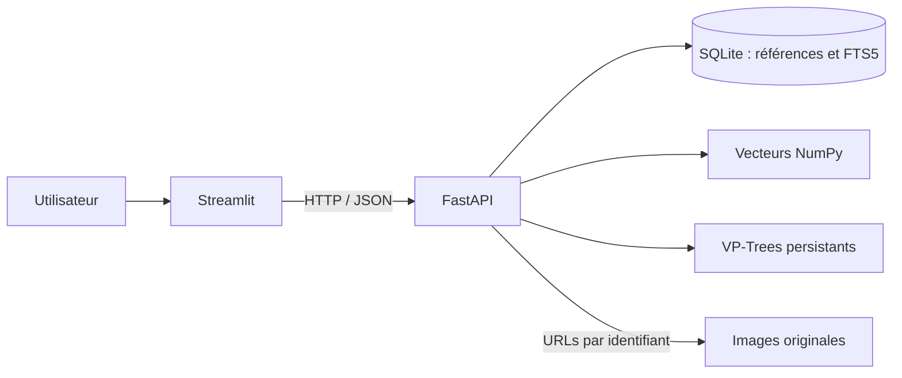
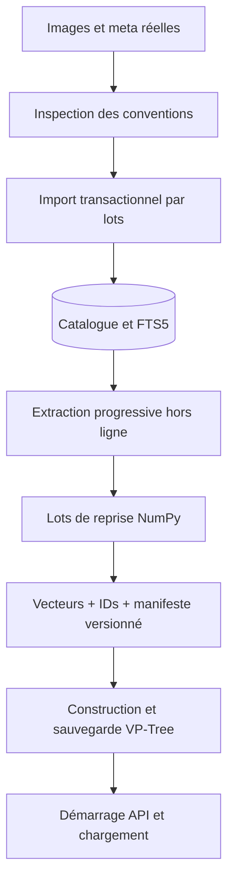
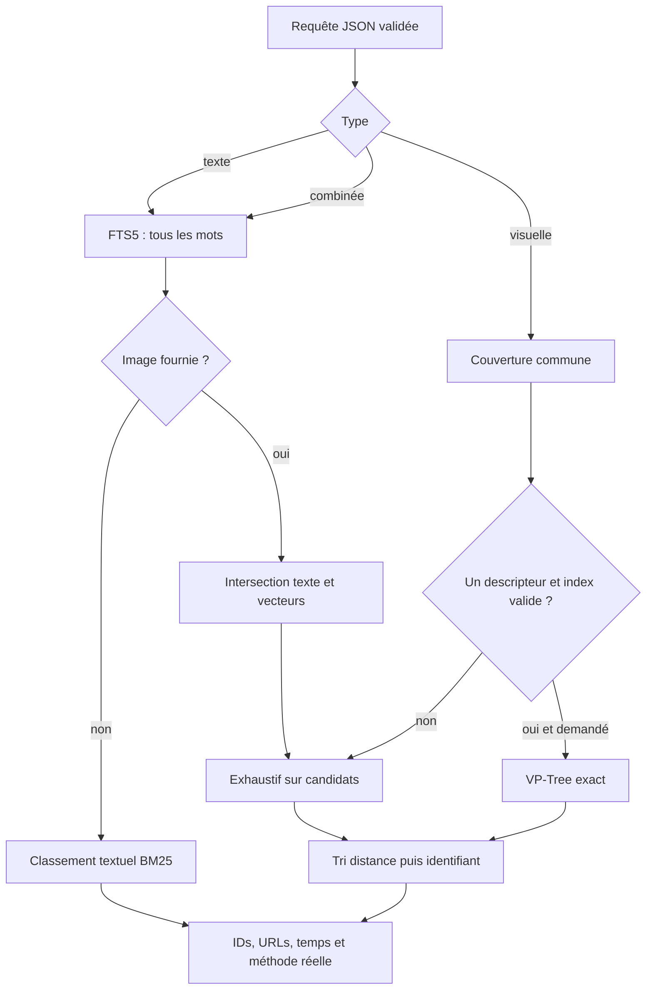
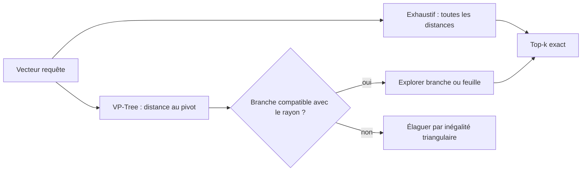

# Architecture et contrats

Le client ne lit ni SQLite ni les fichiers de descripteurs. `IMAGE_SEARCH_API_URL` configure le client ; `IMAGE_SEARCH_DATA_DIR` configure le serveur et les outils hors ligne. `get_settings()` reste la source unique des chemins.

Le schéma est `datasets` → `images` → `image_tags` ← `tags`. L’unicité `(dataset_id,source_id)` conserve les identifiants au réimport. EXIF et licence sont conservés en JSON. Les chemins sont relatifs à chaque base ; sa racine est reconstruite depuis la configuration pour permettre le transfert. Les tags sont aussi indexés dans `image_fts`. Les transactions synchronisent les deux représentations ; les valeurs SQL sont paramétrées.

## API

| Route | Rôle |
| --- | --- |
| `GET /health` | État du serveur |
| `GET /datasets` | Bases, annotations, couverture et index |
| `GET /descriptors?dataset=mirflickr_25k` | Ressources d’une base |
| `GET /images?dataset=mirflickr_25k&offset=0&limit=12` | Galerie paginée |
| `GET /images/{id}` | Métadonnées et URL |
| `GET /images/{id}/file` | Image référencée |
| `POST /search/text` | `dataset`, `keywords`, `k` |
| `POST /search/visual` | `dataset`, `query_id`, `descriptors`, `weights`, `k`, `method` |
| `POST /search/combined` | Même contrat avec mots-clés obligatoires |

`method` vaut `exhaustive` ou `indexed`. La réponse indique `method_used`, `elapsed_ms` et un éventuel `message`. Les résultats visuels contiennent `distance`, les réponses indiquent `candidate_count`, `searchable_images`, `evaluated`. Le texte utilise `text_score=-bm25(...)`, ordre décroissant ; ce score n’est pas une probabilité. Le visuel trie par `(distance,id)`.

Les ressources sont chargées au démarrage de chaque processus API. Redémarrer après préparation hors ligne ; éviter de modifier les artefacts pendant leur utilisation. Les signatures lient catalogue, paramètres et bibliothèques aux vecteurs, puis lient les index à ces vecteurs et à leurs identifiants. Les dates et tailles des sources sont relevées à l’import ; réimporter après modification des sources. NumPy est toujours chargé sans pickle.

## Extension MPEG-7 et Objects

`src/mpeg7_loader.py` lit directement les deux formats réellement inspectés : Edge Histogram (150 valeurs) et Homogeneous Texture (43 valeurs). `scripts.verify_mpeg7_mapping` établit les identités par contenu face à l’archive d’images officielle, via HTTP Range, sans télécharger ni extraire la collection. Les 24 988 associations validées sont stockées explicitement ; douze images dont le contenu ne correspond pas sont exclues. Voir [les preuves et limites](mpeg7.md).

L’importeur ne lit que les membres ZIP associés au catalogue et publie `vectors.npy`, `ids.npy` et `manifest.json` dans deux dossiers distincts des signatures calculées. Les valeurs brutes restent sur disque ; `FeatureStore` applique une normalisation L2 par ligne au chargement. La distance de recherche est euclidienne divisée par 2, métrique et bornée, également utilisée dans les VP-Trees et la fusion. Il s’agit du choix de ce moteur, sans prétendre implémenter les distances MPEG-7 de référence.

Le registre distingue `METHODS` (HSV/LBP/HOG à calculer) et `SEARCH_METHODS` (incluant les deux familles importées). L’extraction et les anciens benchmarks restent limités aux signatures calculées par défaut. L’API expose `family`, `dimension`, `count`, `missing_images`, `distance` et `mpeg7_available` à partir des caches valides ; le client affiche uniquement les ressources effectivement chargées.

Objects peut déjà être importé depuis `raw/objects/images/`, puis recevoir HSV/LBP/HOG. Son format d’annotation n’est pas supposé : adapter l’import après réception et inspection des fichiers.
