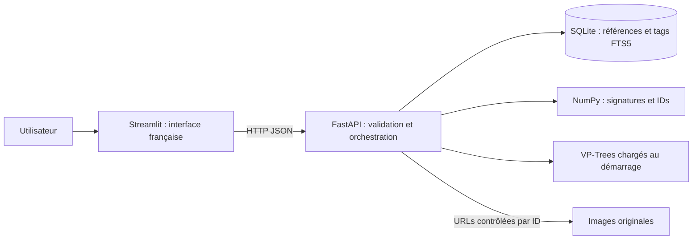
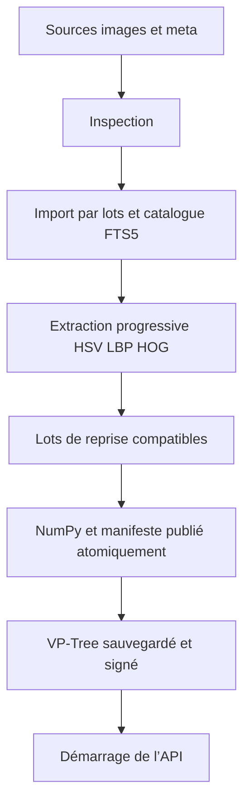
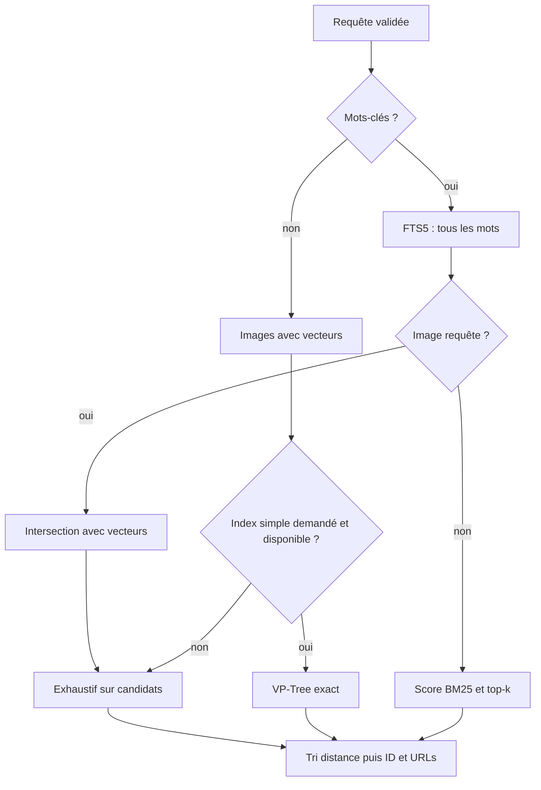
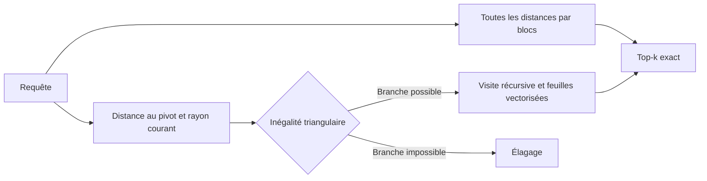
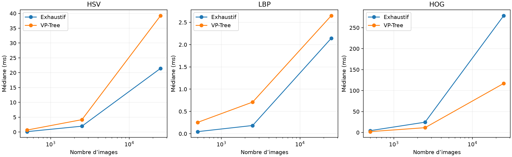

# Prisme — moteur de recherche textuelle et visuelle

Projet universitaire, livraison locale du 25 octobre 2026. Le cahier des charges est le texte fourni ; le PDF de cours n’était pas accessible. L’implémentation conserve l’organisation initiale et `backend/config.py`.

## 1. Problème et objectifs

Retrouver des images d’une collection par mots-clés, par ressemblance visuelle ou en combinant les deux. Le système doit afficher la requête, classer les résultats par ressemblance et permettre de repartir d’un résultat. Une architecture client/serveur permet de dissocier interface et ressources d’indexation.

Les livrables sont le code, le catalogue, les signatures/index persistants, l’application, les mesures et ce rapport. L’objectif démontré porte sur les données réellement présentes. La validation sur Objects et MIRFLICKR-1M dépend de fichiers absents ; MIRFLICKR-25K ne les remplace pas.

## 2. Exigences et choix d’implémentation

Python 3.12, scikit-image, NumPy, Pillow, SQLite/FTS5, FastAPI, Streamlit et pytest forment le socle. Pillow assure le décodage et le redimensionnement ; scikit-image calcule HSV, LBP et HOG. Les échanges client/serveur sont HTTP/JSON. Les images restent en répertoires ; les vecteurs sont calculés hors ligne et stockés séparément.

Le code privilégie des fonctions courtes et des modules correspondant aux phases du cahier des charges. Pas d’OpenCV, de modèle neuronal, de téléchargement automatique de grands jeux de données ni de parseur MPEG-7 hypothétique. Docker n’apporte rien à la validation locale demandée et n’est pas ajouté.

L’environnement Windows CPython 3.12 de `.venv` est distinct du Python MSYS2 global sans pip. Les versions réellement installées sont figées dans `requirements-lock.txt` et enregistrées dans `benchmarks/environment.json`.

## 3. Données réellement utilisées

L’inspection a trouvé 25 000 JPEG sous `raw/mirflickr_25k/images/mirflickr25k/mirflickr/`, ainsi que cinq dossiers `meta/` de 25 000 fichiers chacun. Les fichiers utiles occupent 3 105 579 299 octets. Les images ont exactement les identifiants source 1 à 25 000, avec un fichier `tagsN.txt` pour chaque `imN.jpg`. Les exemples 1, 2, 10, 100 et 25000 sont reproduits dans l’inventaire et son JSON.

Le dossier `mirflickr_25k/descriptors/doc/` ne contient que des informations de collection, fréquences de tags et propriétaires. Deux archives de descripteurs MPEG-7 ont ensuite été reçues dans `mirflickr_1m/descriptors/` et sont exploitées sans extraction massive, après vérification de contenu : voir la section 14. Aucune image Objects ou MIRFLICKR-1M n’est importée. Les images locales n’ont pas été dupliquées.

Les licences individuelles sont conservées. Le readme local demande une utilisation pour la recherche, la conservation des répertoires meta lors de la redistribution de la collection, et la citation de Huiskes et Lew, ACM MIR 2008. Ces indications ne dispensent pas d’examiner les licences individuelles pour un nouvel usage.

## 4. Architecture client/serveur

Le client n’accède ni à SQLite ni aux fichiers de descripteurs. Il obtient les bases, images et résultats via l’API. Les images sont servies par une route qui résout un identifiant interne ; aucun chemin arbitraire n’est accepté. Les chemins résolus doivent rester dans la racine de la base, y compris après résolution des liens.

L’API charge une fois les ressources de chaque processus. Il faut la redémarrer après préparation hors ligne. Un rechargement automatique pendant l’écriture d’artefacts n’est pas implémenté.

## 5. Catalogue et annotations

`datasets(id,name,root)` identifie les bases. `images` contient identifiant interne, clé étrangère, identifiant source, chemin relatif, dimensions décodées, taille, date de modification et métadonnées JSON. `tags` déduplique les tags normalisés en minuscules Unicode ; `image_tags` est la relation plusieurs-à-plusieurs. Une table virtuelle FTS5 indexe le texte des tags pour chaque identifiant image.

L’unicité `(dataset_id,source_id)` et les mises à jour sur conflit rendent le réimport idempotent sans changer les identifiants internes. Les anciennes entrées ne sont pas supprimées automatiquement. Le code utilise des requêtes paramétrées et active les clés étrangères à chaque connexion. Les commits par lots limitent le volume d’une transaction ; en cas d’arrêt, les lots précédents restent importés et le réimport reprend sans doublon.

Chaque image est décodée pendant l’import ; les fichiers illisibles sont consignés et ignorés. Les annotations orphelines sont distinguées des annotations hors de la sélection `--limit`. Les EXIF et licences disponibles sont conservés textuellement en JSON, sans inventer de champs absents. Les dimensions EXIF ne remplacent pas les dimensions réellement décodées.

Les fichiers `tagsN.txt` contiennent des tags utilisateur. Ni leurs fréquences globales ni leur présence ne constituent une classification exhaustive. Les annotations absentes sont signalées dans l’API et l’interface ; aucun résultat textuel fictif n’est produit.

Sur la collection importée, 22 872 images ont des tags non vides et 2 128 fichiers de tags sont vides. Le vocabulaire contient 69 099 tags et la relation `image_tags` 223 535 associations. Les 25 000 images sont présentes dans l’index FTS5. Le contrôle d’intégrité SQLite est positif, sans violation de clé étrangère.

## 6. HSV, LBP et HOG

Le prétraitement corrige l’orientation EXIF, compose la transparence sur fond blanc, convertit en RGB et redimensionne en 64 × 64 pixels avec interpolation bilinéaire. Le changement de rapport d’aspect simplifie les dimensions fixes, au prix d’une déformation possible. Les images grises, palettisées et transparentes sont acceptées.

| Signature | Paramètres par défaut | Dimension | Intuition |
| --- | --- | ---: | --- |
| HSV | histogramme joint, 8 × 4 × 4 cases | 128 | Répartition des teintes, saturations et luminosités |
| LBP | uniforme, 8 voisins, rayon 1 | 10 | Répartition de motifs locaux de texture |
| HOG | 9 orientations, cellules 8 × 8, blocs 2 × 2 | 1 764 | Organisation spatiale des contours |

HSV convertit RGB en HSV puis compte les pixels par case. LBP utilise une luminance quantifiée sur 8 bits pour éviter l’instabilité de comparaisons sur des flottants ; les codes uniformes fournissent `P+2` cases. Pour ces deux histogrammes, on normalise la somme à 1 puis on prend la racine carrée. HOG utilise des blocs `L2-Hys`, puis une normalisation L2 globale. Les trois sorties sont positives, finies et de norme L2 inférieure ou égale à 1 ; une image uniforme peut produire un HOG nul, qui reste valide.

Les paramètres sont configurables par `DescriptorConfig` et par la commande d’extraction : taille, cases HSV, points/rayon LBP, cellules/blocs/orientations HOG. Les contrôles rejettent les configurations incohérentes et les valeurs non finies.

Chaque base et méthode possède ses vecteurs `.npy`, IDs `.npy`, lots de reprise et manifeste JSON dans un dossier séparé. Les images sont traitées progressivement ; seuls quelques lots d’images sont décodés simultanément. La matrice finale est assemblée en memmap. Un manifeste n’est publié qu’après la fin de l’assemblage. Les lots déjà terminés sont réutilisés avec la même sélection et les mêmes paramètres.

Le cache enregistre paramètres, version du code de descripteur, versions des bibliothèques, empreinte du catalogue, couverture, erreurs et empreinte des vecteurs. Un changement de paramètres ou du catalogue impose une génération compatible. L’empreinte des sources se fonde sur les tailles et dates relevées à l’import ; un réimport est nécessaire après modification des fichiers. Les générations précédentes sont conservées, ce qui peut nécessiter un nettoyage manuel lorsque le stockage est limité.

## 7. Distances et fusion

La distance de chaque famille est `d_m(x,y) = ||v_m(x)-v_m(y)||₂ / √2`. Pour les histogrammes transformés, il s’agit de la distance de Hellinger. Pour HOG, c’est une distance euclidienne sur vecteurs normalisés. Toutes sont métriques et comparables sur une échelle fixe de 0 à 1, aux arrondis près. Un vecteur nul reste compatible avec cette métrique.

La fusion est `D = Σ α_m d_m`, avec `α_m = w_m / Σ w_m`. Les poids doivent être finis, non négatifs et de somme positive. Le calcul les redimensionne d’abord par leur maximum pour éviter le dépassement numérique. Un poids nul désactive la contribution de la famille. La normalisation ne dépend jamais du minimum ou maximum des résultats d’une requête ; une même paire conserve sa distance avec les mêmes paramètres.

Les candidats doivent disposer de tous les descripteurs actifs. Leur intersection définit la couverture réellement interrogeable. Une requête sans vecteur est refusée avec explication ; une couverture partielle est signalée. L’image requête est exclue par défaut. Les ex æquo sont départagés par identifiant interne croissant.

## 8. Recherche textuelle et combinée

FTS5 avec `unicode61 remove_diacritics 2` tokenise les tags. La saisie est découpée en mots Unicode ; chaque mot est cité comme un littéral, puis relié par `AND`. Guillemets, parenthèses, opérateurs et ponctuation ne sont donc pas interprétés comme des commandes FTS. Une saisie sans mot renvoie une liste vide. Les longueurs et nombres de mots sont bornés. Les mots anglais des tags doivent être saisis sans attendre de traduction automatique, stemming ou expansion sémantique.

Le texte utilise `-bm25` comme score décroissant. La recherche combinée récupère tous les identifiants correspondant au texte, intersecte leur ensemble avec la couverture visuelle, puis classe visuellement. Elle ne limite pas les candidats au top-k textuel. Aucun candidat donne une liste vide. Une image requête peut ne pas porter les mots-clés : elle sert uniquement à classer les images qui les portent.

## 9. Exhaustif et VP-Tree

La référence exhaustive calcule les distances par blocs vectorisés NumPy, en accumulation float64 pour la reproductibilité. Le top-k résulte d’un tri `(distance,id)`. Le blocage limite la mémoire temporaire, particulièrement pour HOG.

Le VP-Tree choisit un pivot de façon déterministe, classe les autres points selon leur distance au pivot, puis coupe à la médiane. Les feuilles de 32 points utilisent un calcul vectorisé. La recherche conserve un tas des k meilleurs candidats ; le rayon courant et l’inégalité triangulaire éliminent les branches impossibles. Une tolérance conservatrice explore davantage près des frontières plutôt que de manquer un voisin. Les égalités au seuil sont traitées dans les deux branches lorsque nécessaire.

Les index se sauvegardent sous forme de tableaux NumPy, sans pickle. Leur signature doit correspondre aux vecteurs et aux IDs avant rechargement. Un index manquant ou obsolète provoque un repli exhaustif annoncé. Il n’existe pas d’index préconstruit pour la fusion : même si une somme de distances métriques reste métrique pour les composantes actives, le moteur utilise explicitement l’exhaustif pour ces poids variables. Les recherches avec filtre textuel utilisent aussi l’exhaustif sur les candidats pour préserver l’exactitude.

La grande dimension et la concentration des distances peuvent empêcher l’élagage. Un arbre exact en Python peut coûter plus cher qu’un calcul vectorisé sur toute la matrice. Seules les mesures permettent de conclure au gain ou à la perte de temps.

## 10. API et interface

L’API expose état, bases/couverture, descripteurs/index, galerie paginée, détails d’image, service des images et trois routes de recherche. Les contrats détaillés figurent dans `docs/architecture.md` et dans `/docs`. Pydantic valide noms des bases, IDs, méthodes, descripteurs, poids et k. Les mauvaises requêtes produisent des réponses 422 ; les ressources inexistantes des 404.

Les réponses incluent IDs internes et source, base, URLs, tags et dimensions. Elles distinguent `distance` et `text_score`, annoncent la méthode réelle, le temps, les candidats et la couverture commune. Les temps de l’API incluent filtrage, classement et construction des éléments de réponse, hors transport HTTP et affichage ; ceux du benchmark isolent le moteur.

L’interface française propose base, mots-clés, signatures, poids, k, méthode, galerie paginée, requête affichée et résultats avec distances. Les boutons de résultat relancent une recherche avec cette image. La sélection et les résultats sont conservés par base dans l’état Streamlit. Les ressources absentes sont expliquées et ne sont pas présentées comme disponibles. Le serveur indisponible, les annotations absentes et les résultats vides ont des messages spécifiques.

## 11. Protocole et résultats mesurés

Le protocole utilise les mêmes identifiants de requête, tirés sans remise avec graine 2026 dans le plus petit sous-ensemble, pour HSV, LBP et HOG. Les bases de test sont imbriquées : premiers IDs internes communs, tailles 500, 2 500 et 25 000 si cette couverture est disponible. Ce choix assure une comparaison contrôlée, sans prétendre à un échantillonnage uniforme de toute la collection pour les requêtes.

Pour chaque couple taille/signature, le benchmark reconstruit et sauvegarde un VP-Tree, mesure son chargement, effectue une requête d’échauffement puis 20 requêtes mesurées par méthode, avec k=10 et exclusion de la requête. L’ordre exhaustif/indexé alterne selon la requête. Les temps sont mesurés par `perf_counter`. Les coûts d’extraction, de construction, de sauvegarde, de chargement et de recherche restent séparés. Les tableaux de recherche donnent médiane et percentile 95, pas uniquement une moyenne.

La référence exhaustive traite les distances par blocs de 2 048 lignes ; les feuilles du VP-Tree en contiennent 32. Cette différence de granularité influence la localité mémoire, particulièrement avec HOG. Le benchmark mesure ces implémentations précises, sans prétendre que la référence exhaustive est optimisée au maximum. Les mesures finales ont été relancées après le démarrage des services et la validation du parcours, sans recherche utilisateur concurrente.

Les voisins du VP-Tree doivent avoir les mêmes IDs et distances que l’exhaustif. Le départage déterministe des distances égales rend cette comparaison plus stricte qu’une simple égalité à permutations près. Les tests synthétiques ajoutent des vecteurs identiques pour exercer les égalités.

<!-- RESULTS_START -->
Exécution réelle : **35 tests, 0 échec/erreur, 0 test ignoré** (JUnit `benchmarks/tests.xml`).

Essai préalable isolé : 32 images réelles, réimport stable et trois index exacts ; état passed.

Import : **25000 images**, 0 illisible(s), 22872 images avec tags non vides, 0 annotation(s) orpheline(s), en 109.14 s.

Environnement : Python 3.12.13, Windows-11-10.0.26200-SP0, 8 processeurs logiques ; 11th Gen Intel(R) Core(TM) i7-1165G7 @ 2.80GHz, RAM 23.7 Go.

| Signature | Couverture | Dimension | Extraction (s) | Construction production (s) | Chargement vecteurs production (s) |
| --- | ---: | ---: | ---: | ---: | ---: |
| HSV | 25000/25000 | 128 | 66.20 | 0.315 | 0.292 |
| LBP | 25000/25000 | 10 | 57.01 | 0.062 | 0.314 |
| HOG | 25000/25000 | 1764 | 67.77 | 4.245 | 0.670 |

Les durées d’extraction incluent décodage, calcul et sauvegarde ; elles correspondent à la dernière exécution publiée du manifeste. Les coûts de chargement dépendent du cache disque du système.

Recherche moteur : **20 requêtes par couple taille/signature**, k=10, graine=2026. Même liste de requêtes pour chaque comparaison.

| Signature | Images | Méthode | Requêtes | Médiane (ms) | p95 (ms) | Distances évaluées en moyenne |
| --- | ---: | --- | ---: | ---: | ---: | ---: |
| HSV | 500 | exhaustive | 20 | 0.131 | 0.192 | 500.0 |
| HSV | 500 | vp_tree | 20 | 0.658 | 1.217 | 492.3 |
| HSV | 2500 | exhaustive | 20 | 1.967 | 4.473 | 2500.0 |
| HSV | 2500 | vp_tree | 20 | 4.167 | 6.495 | 2109.3 |
| HSV | 25000 | exhaustive | 20 | 21.456 | 31.990 | 25000.0 |
| HSV | 25000 | vp_tree | 20 | 39.225 | 59.004 | 20327.8 |
| LBP | 500 | exhaustive | 20 | 0.046 | 0.058 | 500.0 |
| LBP | 500 | vp_tree | 20 | 0.254 | 0.441 | 245.1 |
| LBP | 2500 | exhaustive | 20 | 0.184 | 0.211 | 2500.0 |
| LBP | 2500 | vp_tree | 20 | 0.710 | 1.515 | 513.0 |
| LBP | 25000 | exhaustive | 20 | 2.142 | 2.382 | 25000.0 |
| LBP | 25000 | vp_tree | 20 | 2.650 | 5.800 | 2064.8 |
| HOG | 500 | exhaustive | 20 | 4.353 | 6.643 | 500.0 |
| HOG | 500 | vp_tree | 20 | 2.039 | 3.588 | 500.0 |
| HOG | 2500 | exhaustive | 20 | 24.562 | 35.644 | 2500.0 |
| HOG | 2500 | vp_tree | 20 | 11.458 | 18.306 | 2496.2 |
| HOG | 25000 | exhaustive | 20 | 278.681 | 324.221 | 25000.0 |
| HOG | 25000 | vp_tree | 20 | 117.032 | 137.628 | 25000.0 |

| Signature | Images | Construction (s) | Sauvegarde (s) | Chargement index (s) |
| --- | ---: | ---: | ---: | ---: |
| HSV | 500 | 0.0013 | 0.0019 | 0.0012 |
| HSV | 2500 | 0.0131 | 0.0042 | 0.0007 |
| HSV | 25000 | 0.2241 | 0.0046 | 0.0015 |
| LBP | 500 | 0.0006 | 0.0025 | 0.0006 |
| LBP | 2500 | 0.0041 | 0.0054 | 0.0008 |
| LBP | 25000 | 0.0444 | 0.0044 | 0.0010 |
| HOG | 500 | 0.0235 | 0.0024 | 0.0007 |
| HOG | 2500 | 0.2133 | 0.0032 | 0.0007 |
| HOG | 25000 | 3.1963 | 0.0049 | 0.0012 |

Accord des voisins **exact sur toutes les requêtes mesurées**, identifiants et distances vérifiés. Cette exactitude porte sur les signatures et métriques utilisées, pas sur un jugement humain de pertinence.

Validation HTTP réelle : **passed**, 8 URLs comparées octet pour octet aux images attendues, recherche à partir d’un résultat validée. Aucun candidat pour le mot inexistant.

Analyse à la taille maximale :

- HSV : le VP-Tree est 1.83 fois plus lent en médiane que l’exhaustif.
- LBP : le VP-Tree est 1.24 fois plus lent en médiane que l’exhaustif.
- HOG : le VP-Tree est 2.38 fois plus rapide en médiane que l’exhaustif.
  Pour HOG, au moins 99 % des distances sont évaluées : le VP-Tree n’élague pratiquement pas. Un avantage temporel éventuel vient ici des petits blocs/feuilles et de leur localité mémoire, pas d’une réduction significative du nombre de distances.

Le nombre de distances effectivement évaluées montre la capacité d’élagage. Le coût Python des visites et les calculs par petits blocs expliquent qu’un index exact puisse perdre face à NumPy même en évaluant moins de distances. HOG concentre des informations en grande dimension : aucun gain systématique n’est attendu.

Interface Streamlit connectée à l’API réelle : **passed**, catalogue de 25000 images. Sélection, exhaustif, index exact, fusion, filtre combiné, relance depuis un résultat, résultat vide et pagination validés par AppTest (`interface_smoke.json`). Aucun navigateur automatisable n’était disponible : aucun contrôle visuel dans un navigateur n’est revendiqué. La validation sur PC LIASA reste à réaliser.
<!-- RESULTS_END -->

Le graphique exportable est `benchmarks/search_times.png`. Les mesures brutes sont dans `search_raw.csv`, les agrégats dans `summary.csv`, les coûts hors recherche dans `stages.csv`, les paramètres et l’environnement dans leurs JSON. Les durées d’extraction et de construction des index de production sont conservées séparément. Les tests ne prouvent pas à eux seuls la pertinence sémantique : aucune Precision@k ou mAP n’est calculée sans vérité terrain fiable.

## 12. Limites et améliorations

Objects et les images MIRFLICKR-1M restent absents. Les deux familles MPEG-7 reçues sont maintenant intégrées sur 24 988 images du sous-ensemble 25K dont l’identité a été vérifiée. Douze images restent exclues de ces familles, faute de correspondance de contenu confirmée. Toute autre famille doit encore être inspectée et validée avant activation.

L’échelle testée reste celle de MIRFLICKR-25K. La performance d’un PC LIASA n’est pas celle de cette machine : installation, chemins et ressources doivent être vérifiés sur place. Les modèles de couleur/texture/contours n’ont pas de compréhension sémantique. Un ciel et une mer peuvent partager des couleurs sans représenter le même objet. Le redimensionnement déforme les proportions ; des pyramides spatiales ou plusieurs résolutions pourraient améliorer certains cas.

La gestion de catalogue ne déduit pas qu’un fichier supprimé implique la suppression d’une ligne. Les racines et manifestes sont prévus pour une préparation hors ligne suivie d’un redémarrage. Pour une exploitation multi-utilisateur, on pourrait ajouter tâches d’administration, authentification et publication de générations complètes. Ces fonctions ne sont pas nécessaires à la démonstration locale. Le benchmark ne prétend pas mesurer le transport réseau, l’affichage Streamlit ou tous les états de cache disque.

## 13. Description des fichiers sources utiles

| Fichier | Rôle | Entrées | Sorties |
| --- | --- | --- | --- |
| `backend/config.py` | Configuration existante conservée | Environnement, nom de base | `Settings`, chemins Windows compatibles |
| `backend/schemas.py` | Validation des recherches | JSON client | Paramètres typés ou erreurs |
| `backend/main.py` | Routes, durée de vie et service sécurisé des images | HTTP | JSON et fichiers image |
| `src/database.py` | Schéma, connexions, signature et résolution sûre | Chemin du catalogue, lignes | SQLite, empreinte, chemin autorisé |
| `src/data_loader.py` | Import progressif et annotations observées | Sources, base, limite | Catalogue et bilan |
| `src/descriptors.py` | Prétraitement et signatures | Image, méthode, paramètres | Vecteur fixe fini |
| `src/feature_store.py` | Extraction, reprise, validation et lecture de cache | Catalogue, images, paramètres | NumPy, manifestes, correspondance IDs |
| `src/mpeg7_loader.py` | Import sélectif des deux formats ZIP observés | Archive et correspondance vérifiée | Matrice brute float32, IDs, manifeste |
| `src/remote_zip.py` | Accès HTTP Range en lecture seule, borné à 32 Mio | URL officielle et plages | Répertoire ZIP et exemples sans téléchargement complet |
| `src/text_search.py` | Requête FTS littérale avec AND | Base et mots-clés | Images et scores textuels |
| `src/visual_search.py` | Ressources, fusion, exhaustif et repli | Image, signatures, poids, candidats | Top-k, couverture, méthode, temps |
| `src/vp_tree.py` | Distance et arbre métrique exact | Matrice et IDs | Arbre sauvegardable et voisins |
| `frontend/api_client.py` | Accès HTTP et erreurs lisibles | Adresse API, paramètres | Réponses JSON |
| `frontend/app.py` | Interface et état de sélection | Interactions, API | Galerie, requête et résultats |
| `scripts/inspect_data.py` | Inventaire reproductible | Répertoires locaux | `data_inspection.json` |
| `scripts/inspect_mpeg7.py` | Inspection directe des ZIP et de leurs labels | Deux ZIP originaux | Inventaire et échantillons JSON |
| `scripts/verify_mpeg7_mapping.py` | Association par contenu aux images officielles | Catalogue, JPEG locaux, plages HTTP de référence | Correspondance signée et preuves |
| `scripts/import_mpeg7.py` | Commande d’import sélectif | Correspondance validée et ZIP | Deux matrices compactes et bilan |
| `scripts/validate_mpeg7.py` | Validation sur catalogue, API et Streamlit réels | Deux familles importées | Accord exact, parcours et préservation SHA-256 |
| `scripts/validate_subset.py` | Essai isolé sur 32 images réelles | Sources existantes sans duplication | Bilan d’import, signatures et voisins exacts |
| `scripts/validate_interface.py` | Parcours Streamlit avec l’API réellement démarrée | API et catalogue réels | Bilan JSON d’interactions |
| `scripts/import_dataset.py` | Commande d’import | Arguments CLI | Catalogue et `import.json` |
| `scripts/extract_features.py` | Commande d’extraction/reprise | Paramètres CLI | Vecteurs et `extraction.json` |
| `scripts/build_indexes.py` | Commande de construction | Vecteurs validés | Index et `index_build.json` |
| `scripts/search_cli.py` | Recherche locale pédagogique | Texte ou ID et options | Résultats JSON console |
| `scripts/benchmark.py` | Comparaison contrôlée et vérification exacte | Tailles, requêtes, graine | CSV, JSON, graphique |
| `scripts/smoke_demo.py` | Vérification HTTP sur les vraies images | URL API | Bilan et comparaison d’octets |
| `scripts/report_results.py` | Insérer uniquement les mesures réelles | JSON, CSV et JUnit | Section mesurée de ce rapport |
| `tests/conftest.py` | Images et catalogues temporaires | Dossier pytest | Fixtures isolées |
| `tests/test_import.py` | Idempotence, clés, corruption, orphelins | Fixtures | Assertions |
| `tests/test_descriptors.py` | Dimensions, modes, cache et reprise | Fixtures | Assertions |
| `tests/test_search.py` | Texte, tri, exclusion, fusion, filtre | Fixtures | Assertions |
| `tests/test_indexes.py` | Exactitude, égalités, persistance | Vecteurs aléatoires et fixtures | Assertions |
| `tests/test_api.py` | Contrats, URLs, validation et sécurité | API temporaire | Assertions |
| `tests/test_frontend.py` | Sélection, recherches, relance et panne | Streamlit AppTest avec API temporaire | Assertions |
| `tests/test_mpeg7.py` | Sélection ZIP, preuves, alignement, métrique, API et limites réseau | Petits ZIP et catalogues temporaires | Assertions sans extraction massive |

Les `__init__.py` délimitent les packages. `requirements.txt`, `requirements-lock.txt` et `pytest.ini` fixent installation et collecte des tests. `README.md`, `docs/data_inventory.md`, `docs/architecture.md` et `docs/demo.md` complètent installation, données, contrats et transfert.

## 14. Intégration MPEG-7 depuis les archives

Les ZIP d’Edge Histogram et Homogeneous Texture contiennent chacun un million de petits descripteurs. L’import évite leur extraction : seul le répertoire central est parcouru et les 24 988 membres associés aux images du catalogue sont lus. Les dimensions réelles, confirmées par les fichiers `feature_names.txt`, sont respectivement 150 et 43. Les valeurs fournies sont conservées en float32 dans deux matrices distinctes des anciens vecteurs.

L’association ne repose pas sur les noms ou l’ordre. La documentation officielle établit le lien entre collections, puis la vérification par contenu face à `images0.zip` trouve 24 986 correspondances uniques par CRC32/taille. Quatorze exemples sont comparés par SHA-256, ainsi que deux cas de doublons. Douze images échouent aussi au contrôle des pixels décodés et restent exclues. La correspondance est conservée explicitement avec sa signature et les preuves ; voir [le dossier de vérification](mpeg7.md).

| Famille | Matrice importée | Descripteurs manquants parmi les images associées | Images sans correspondance validée | Import (s) |
| --- | --- | ---: | ---: | ---: |
| Edge Histogram | 24 988 × 150 | 0 | 12 | 13,46 |
| Homogeneous Texture | 24 988 × 43 | 0 | 12 | 11,02 |

Les deux matrices et tableaux d’IDs représentent environ 19,69 Mo. Aucun fichier individuel du ZIP n’est créé. Les deux archives originales et les 612 anciens fichiers de vecteurs/lots/manifestes/index conservent leurs empreintes SHA-256, soit 614 fichiers protégés au total.

Pour la recherche, l’adaptateur applique L2 par ligne au chargement, puis une distance euclidienne divisée par 2. Ce choix métrique est propre au moteur et n’est pas présenté comme la distance MPEG-7 normative. Il permet deux VP-Trees exacts supplémentaires et une fusion à échelle fixe avec les autres méthodes. L’API et Streamlit annoncent la couverture partielle et refusent une image requête sans vecteur vérifié.

La validation réelle confirme l’accord exhaustif/VP-Tree sur 20 requêtes par famille, puis les recherches HTTP indexées, combinées et fusionnées, ainsi que les deux options dans Streamlit AppTest. Ces contrôles sont enregistrés dans `benchmarks/mpeg7_validation.json`. Ils n’étendent pas l’échelle de recherche à un million d’images ; seuls les descripteurs du sous-ensemble local validé sont chargés.

## Références techniques

Le [manuel scikit-image](https://scikit-image.org/docs/stable/api/skimage.feature.html) décrit les méthodes HOG et LBP utilisées. La [documentation FTS5](https://www.sqlite.org/fts5.html) décrit la tokenisation, MATCH et BM25. La [documentation uv](https://docs.astral.sh/uv/guides/install-python/) décrit la préparation d’un CPython indépendant. Les conventions de la collection ont été vérifiées dans les fichiers locaux `descriptors/doc/` et `annotations/meta/`, et non déduites d’une autre base.

Les tests d’interface utilisent [Streamlit AppTest](https://docs.streamlit.io/develop/api-reference/app-testing/st.testing.v1.apptest), qui simule les interactions sans exécuter un navigateur.
